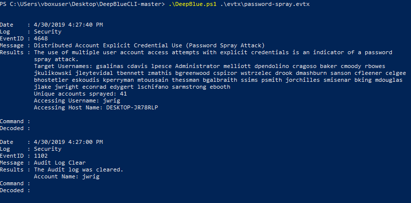

# Windows Event Log Threat Hunting (DeepBlueCLI)

I used **DeepBlueCLI** (a PowerShell tool by SANS) to triage Windows `.evtx` logs that contain real attack activity: password spraying, Mimikatz credential dumping, obfuscated PowerShell, and event log tampering. For each case I ran the tool, read the alerts, and checked the event IDs and timestamps behind them.

**Data:** public attack sample logs (the `.evtx` samples distributed with DeepBlueCLI and the EVTX-ATTACK-SAMPLES collection).
**Tools:** DeepBlueCLI, PowerShell, Windows Event Viewer.

---

## MITRE ATT&CK

| Technique | ID | Log / Event IDs |
| :--- | :--- | :--- |
| Password Spraying | `T1110.003` | Security `4648`, `4625` |
| OS Credential Dumping: LSASS (Mimikatz) | `T1003.001` | Security `4673` (SeDebugPrivilege) |
| PowerShell (obfuscated / encoded commands) | `T1059.001` | PowerShell `4104` |
| Clear Windows Event Logs | `T1070.001` | Security `1102`, System `104` |
| Impair Defenses: Disable Windows Event Logging | `T1562.002` | System `7040` |

---

## 1. Password spraying

```powershell
.\DeepBlue.ps1 .\evtx-attack-samples\Security\password-spray-4625.evtx
```

- **4/30/2019 4:27:00 PM**: Event **1102**, the Security log was cleared just before the attack.
- **4/30/2019 4:27:40 PM**: a burst of Event **4648** (logon with explicit credentials), many accounts tried in a few seconds. That pattern (one password, many users) is password spraying, not a normal user mistyping.



---

## 2. Mimikatz credential dumping

```powershell
.\DeepBlue.ps1 .\evtx\mimikatz-privesc-hashdump.evtx
```

- **4/30/2019 3:08:22 PM**: Event **1102**, log cleared again.
- **4/30/2019 3:08:29 PM** (7 seconds later): Event **4673** showing use of **SeDebugPrivilege**. Mimikatz needs that privilege to read `lsass.exe` memory and dump credentials.

Clearing the log right before using SeDebugPrivilege is a strong sign this was deliberate.


---

## 3. Obfuscated PowerShell (Invoke-Obfuscation)

```powershell
.\DeepBlue.ps1 .\evtx\Powershell-Invoke-Obfuscation-encoding-menu.evtx
```

Script block logging (Event **4104**) on **8/30/2017** shows the same command being obfuscated in several different ways within a few minutes:

| Time | Technique | Why DeepBlueCLI flagged it |
| :--- | :--- | :--- |
| 4:13:38 – 4:13:52 PM | Hex and ASCII arrays converted back at runtime; `iex` built from `$env:ComSpec[4,15,25]` | Only 45–56% of the characters are letters/numbers |
| 4:14:33 – 4:14:51 PM | Binary and octal strings split with `-split 'o' -split '&' -split 'r'` | Over 1,000 bytes, 75% zeros and ones |
| 4:15:23 PM | AES-encrypted SecureString decoded with `PtrToStringBSTR()` | 500+ consecutive Base64 characters |
| 4:15:43 – 4:16:25 PM | Special characters, `-BXor "0x5d"`, `iex` built from character indexes | Only 3–6% letters/numbers |

The goal of all of them is the same: hide the word `iex` (Invoke-Expression) and the real command from simple string matching.


---

## 4. Event log tampering

```powershell
.\DeepBlue.ps1 .\evtx\disablestop-eventlog.evtx
```

- **4/27/2019 6:04:25 PM**: Event **104** in the System log, a log was cleared.
- **6:04:32 – 6:04:51 PM**: Event **7040** in the System log, the Windows Event Log service start type changed from Auto Start to Disabled, and then the service was stopped.

After this, the machine stops recording events, so anything the attacker does next is invisible. In a real SOC, a 7040 on the Event Log service should be a high-priority alert on its own.


---

## Detection idea

Three of the four cases include **log clearing (1102 / 104)** right before or during the attack. An alert on 1102, 104 and 7040 (Event Log service) would have caught all of them early, even without knowing the specific attack.

**Author:** Alejandro José Vargas
